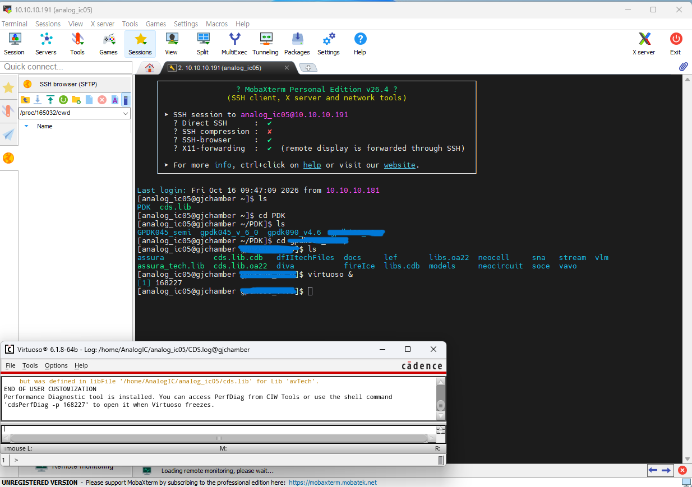
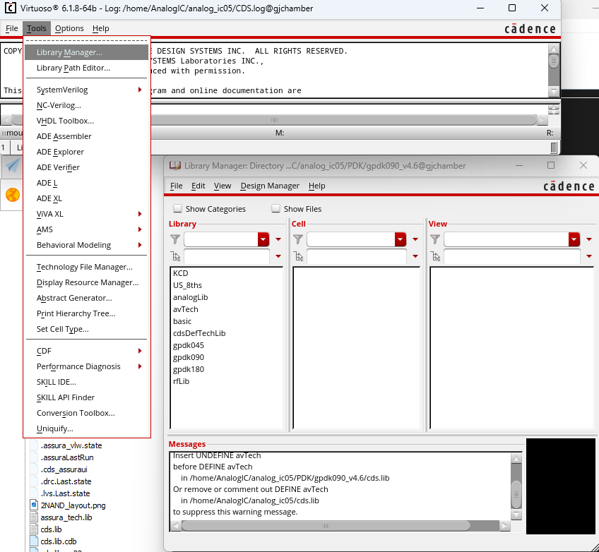

### 1. Cadence Virtuoso tools 실행

---


#### 1.1. MovaXterm 설치 및 실행

<!-- ```bash
sudo apt install git
``` -->

Virtuoso를 실행하기 위해 설치된 `MovaXterm`을 열고, 화면 상단의 `Session`메뉴를 클릭한다.


주어진 서버 ID를 입력하고, `virtuoso &`로 접속한다.   




#### 1.2. Virtuoso 초기 설정

`Tools`의 `Library Manager`에서 Schematic 또는 Layout 작업을 위해 Library를 생성한다.




`File-New`의 `Cell View`를 선택하고, 만들고 싶은 프로젝트 이름과 Type(schematic or layout)을 설정한다.


[목차](../README.md) 

