### 1. 2x1 MUX Logic & Switch

<small>[1.1. 2x1 MUX Schematic](#11-2x1-mux-schematic)</small>

<small>[1.2. Simulation](#12-simulation)</small>

<small>[1.3. 2x1 MUX Layout](#13-2x1-mux-layout)</small>

---

**PMOS Size** : 2.91um (L=100nm, NMOS : 1um)

MUX에 들어가기 앞서, 먼저 Switch의 회로도와 레이아웃을 간략히 살펴보겠다.

Switch는 TR을 사용해서 전기적 연결을 ON-OFF 해준다. 

Schematic과 Layout은 다음 사진과 같다. 

**Layout Size** : 0.94 * 5.82(um)

<table>
  <tr>
    <td align="center">
      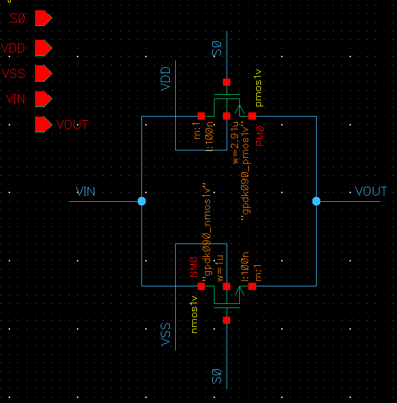
    </td>
    <td align="center">
      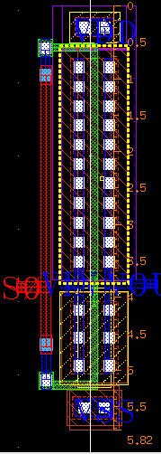
    </td>
  </tr>
</table>

MUX는 입력 신호에 따라 원하는 출력을 요구할 수 있는 기능을 한다. 

4x1 MUX 사진을 예시로 알아보겠다. 

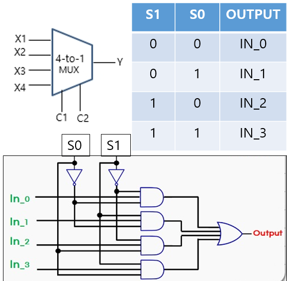  

#### 1.1. 2x1 MUX Schematic

cell view에서 이름은 각각 `2x1 MUX Logic`, `2x1 MUX Switch` Type은 `schematic`을 선택하고 회로도를 그린다.

Logic은 3개의 NAND와 1개의 NOT gate로 구성한다.

Switch는 1개의 NOT gate와 4개의 TR로 구성한다.

완성된 회로도는 다음 사진과 같다.

<table>
  <tr>
    <td align="center">
      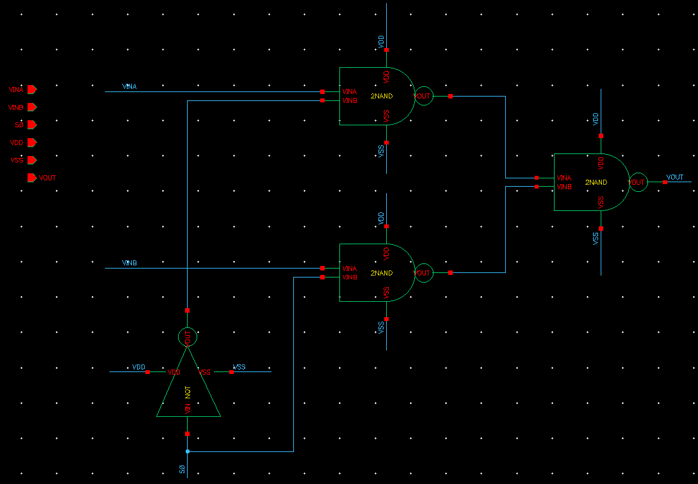
    </td>
    <td align="center">
      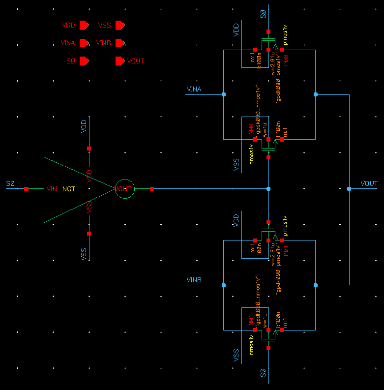
    </td>
  </tr>
</table>

`Create`의 `From Cellview`를 클릭하고, 각각 schematic에 대한 symbol을 생성한다.  

다음과 같이 Symbol을 사용하여 TEST파일을 만든다.

이때, VINA = 1V, VINB와 S0은 vpulse를 설정하여 ON OFF를 확인한다.

<table>
  <tr>
    <td align="center">
      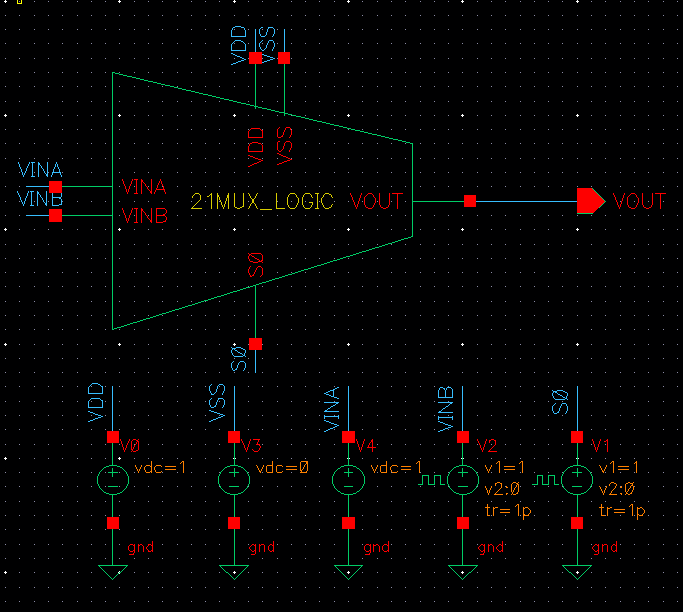
    </td>
    <td align="center">
      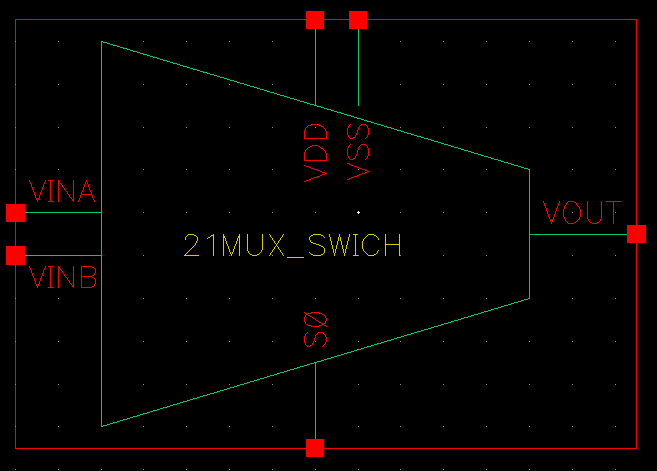
    </td>
  </tr>
</table>

#### 1.2. Simulation

`Launch`의 `ADE L`에서 Schematic에 대한 simulation을 진행한다.

1. `Analyses`에서 입력한 vpulse 주기의 2~3배로 `Tran` 설정을 진행한다.

2. `Results` - `Direct Plot` - `Main Form`에서 그래프 결과를 확인한다.

3. vpulse ON-OFF에 따른 그래프 결과를 확인한다

다음과 같이 Logic과 Switch가 같은 그래프 ON-OFF를 보여주는 것을 확인한다.

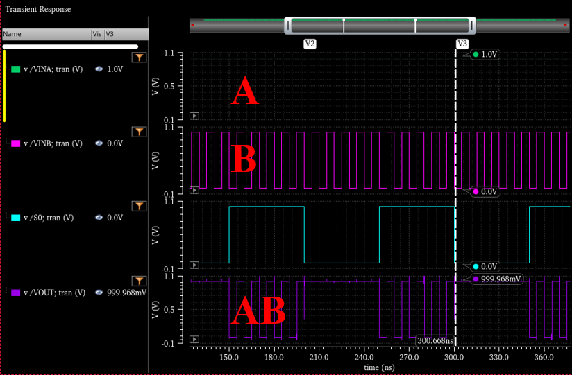  

#### 1.3. 2x1 MUX Layout

각각의 Schematic을 기반으로 Layout을 진행한다. 

먼저 `Options`의 `Display`에서 x와 y의 `Snap Spacing`을 `0.005`로 수정한다.

전체 Layout은 다음과 같다.

<table>
  <tr>
    <td>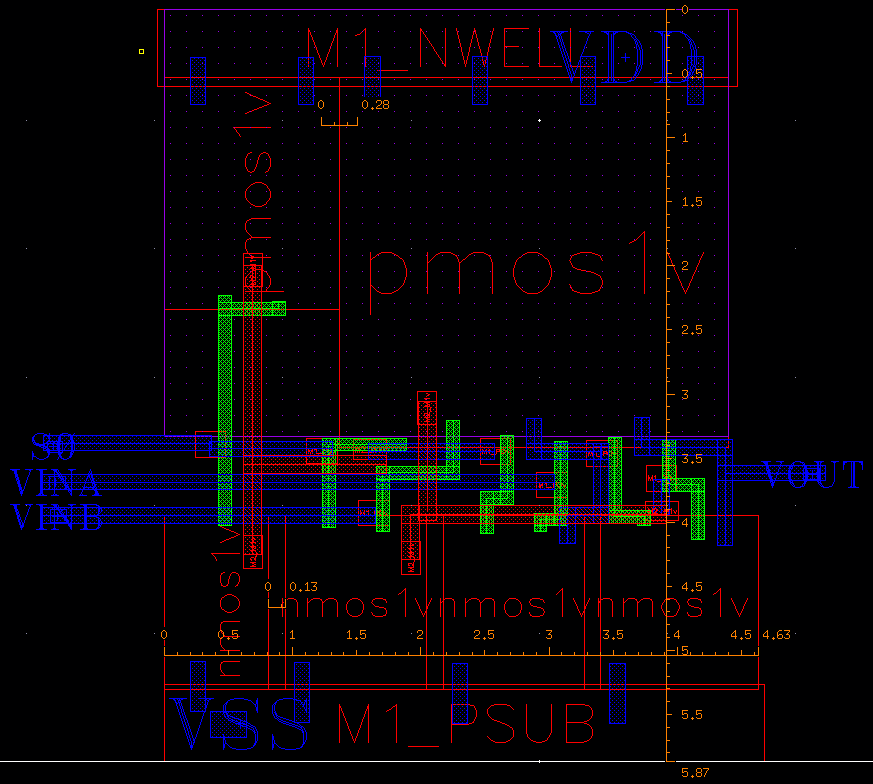</td>
    <td>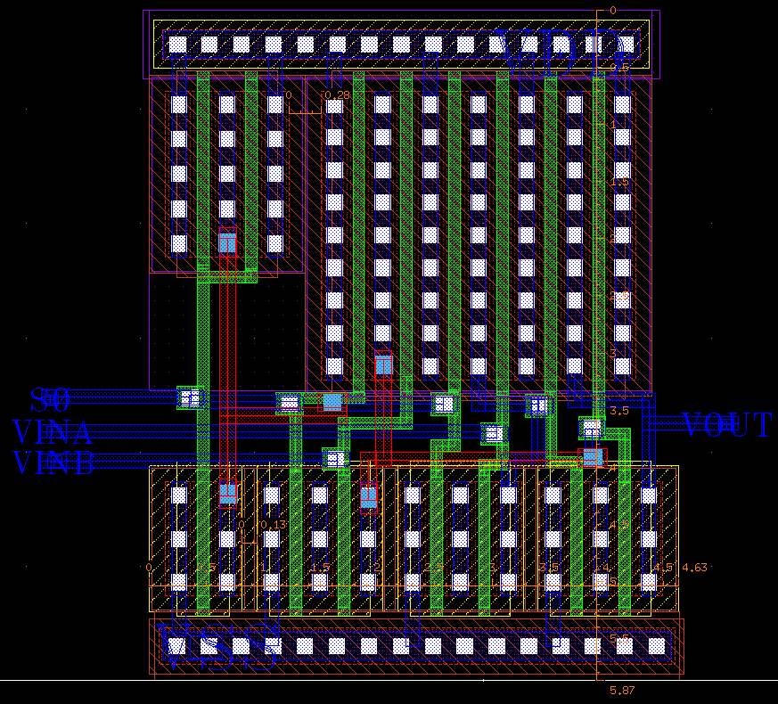</td>
  </tr>
  <tr>
    <td>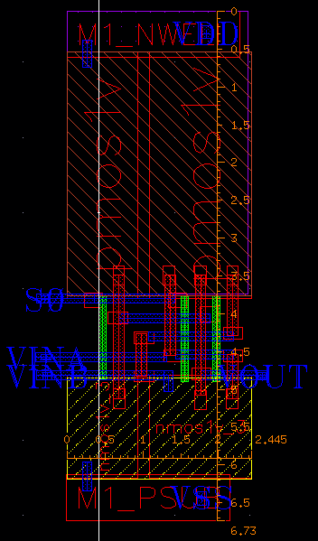</td>
    <td>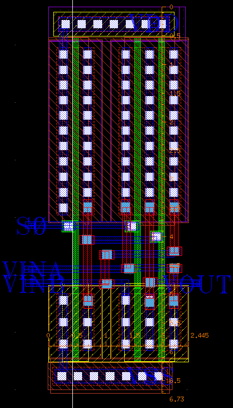</td>
  </tr>
</table>

**Logic** : 이전에 만든 개인 Lib에서 NAND와 NOT을 따로 불러와서 연결한다.

**Switch** : NOT과 TR을 적절히 연결한다.

Schematic에 맞게 poly와 metal을 연결하고 layout을 완성한다.

가로 세로 사이즈는 최소화한다.

**Logic Size** : 4.63 * 5.87(um)

**Switch Size** : 2.445 * 6.73(um)

Logic은 Switch와 비교할 때 3개의 NAND가 필요하기 때문에 더 많은 TR을 사용한다. 따라서 면적이 더 넓어지는 단점을 가진다.

마지막으로 Cadence에서 제공하는 Assura 도구로 Schematic과 Layout에 대한 오류를 확인한다.

첫 번째로, `Assura`에서 `DRC(Design Rule Check)`를 진행한다. DRC는 gpdk090을 기준으로 제조 공정 규칙을 준수하는지 확인한다.

두 번째로 `Assura`에서 `LVS(Layout Versus Schematic)`를 진행한다. Schematic과 Layout 간의 회로 연결 및 설계 오류가 없는지 확인한다.

[목차](../../README.md)

