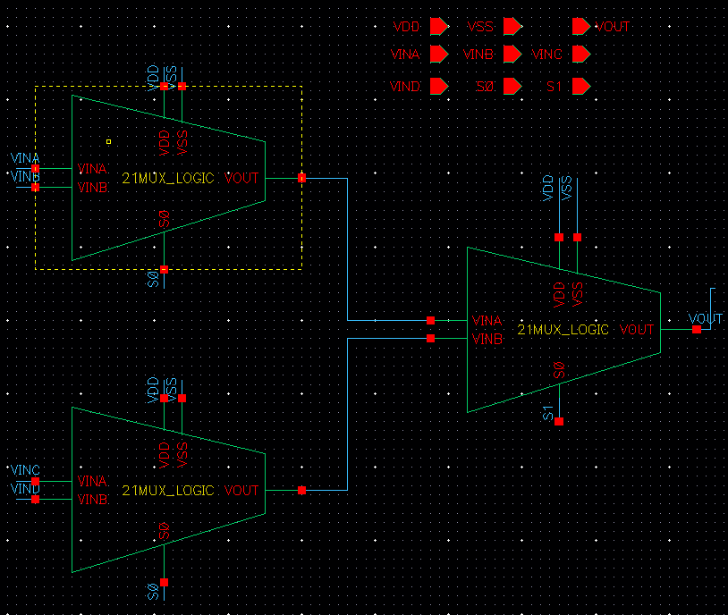
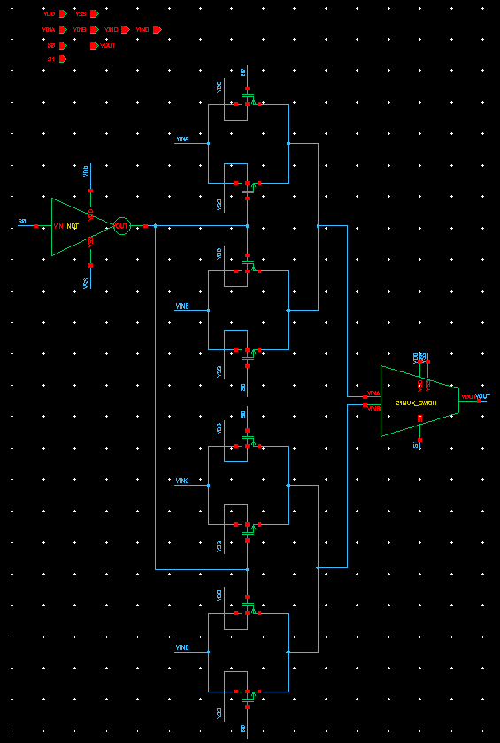
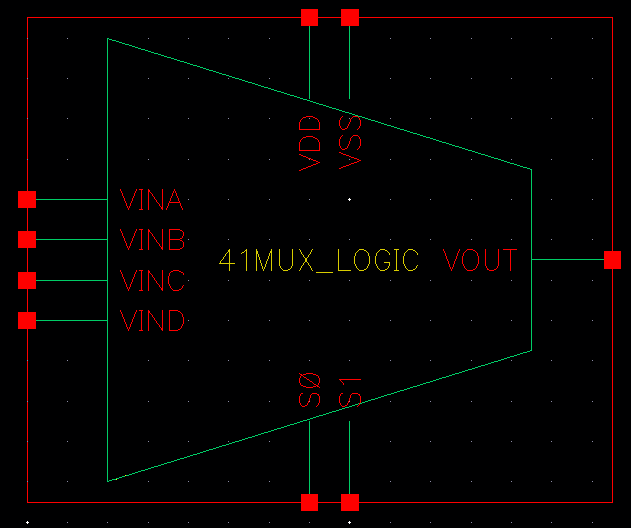
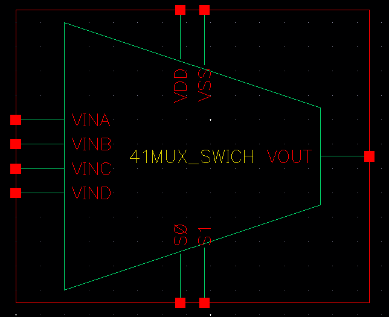
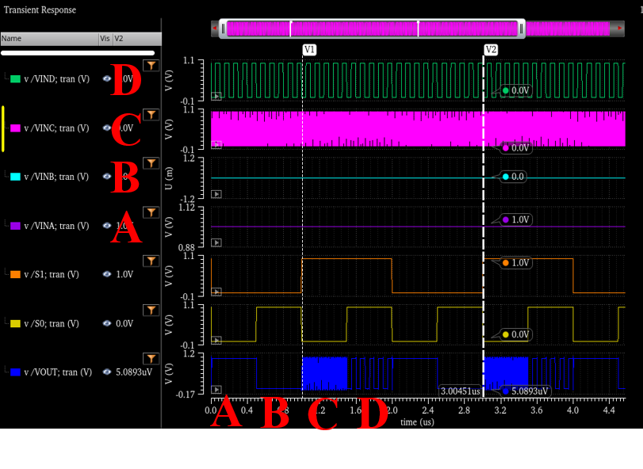
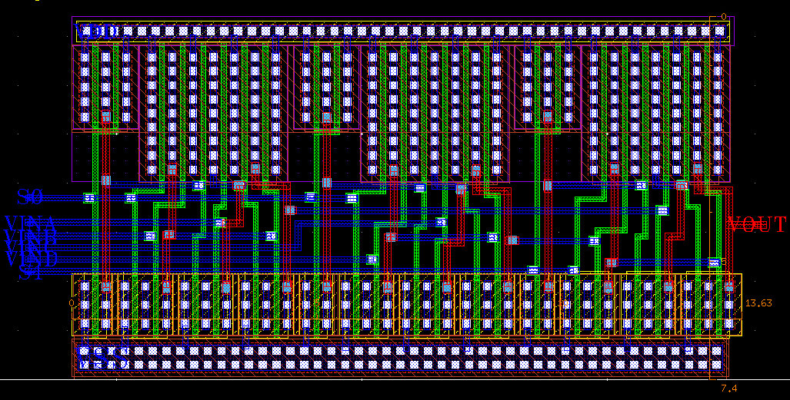
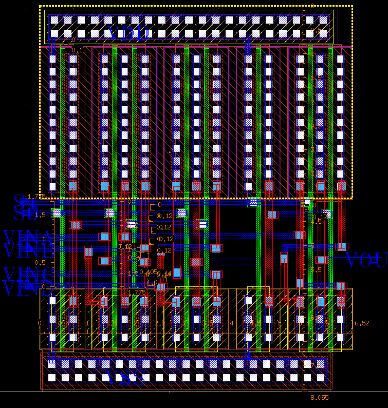

### 1. 4x1 MUX Logic & Switch

<small>[1.1. 4x1 MUX Schematic](#11-4x1-mux-schematic)</small>

<small>[1.2. Simulation](#12-simulation)</small>

<small>[1.3. 4x1 MUX Layout](#13-4x1-mux-layout)</small>

---

#### 1.1. 4x1 MUX Schematic

cell view에서 이름은 각각 `4x1 MUX Logic`, `4x1 MUX Switch` Type은 `schematic`을 선택하고 회로도를 그린다.

Logic은 3개의 2x1 MUX Logic Symbol을 가져와 구성한다.

Switch는 1개의 NOT gate와 TR, 2x1 MUX Switch Symbol로 구성한다.

완성된 회로도는 다음 사진과 같다.

<table>
  <tr>
    <td align="center">
      
    </td>
    <td align="center">
      
    </td>
  </tr>
</table>

`Create`의 `From Cellview`를 클릭하고, 각각 schematic에 대한 symbol을 생성한다.  

<table>
  <tr>
    <td align="center">
      
    </td>
    <td align="center">
      
    </td>
  </tr>
</table>

#### 1.2. Simulation

Symbol을 사용하여 TEST 파일을 만든다.

이때, VINA = 1V, VINB = 0V와 VINC, VIND, S0, S1은 vpulse를 설정하여 VOUT의 ON OFF를 확인한다.

`Launch`의 `ADE L`에서 Schematic에 대한 simulation을 진행한다.

1. `Analyses`에서 입력한 vpulse 주기의 2~3배로 `Tran` 설정을 진행한다.

2. `Results` - `Direct Plot` - `Main Form`에서 그래프 결과를 확인한다.

3. vpulse ON-OFF에 따른 그래프 VOUT 결과를 확인한다

다음과 같이 Logic과 Switch가 같은 그래프 ON-OFF를 보여주는 것을 확인한다.

  

#### 1.3. 4x1 MUX Layout

각각의 Schematic을 기반으로 Layout을 진행한다. 

먼저 `Options`의 `Display`에서 x와 y의 `Snap Spacing`을 `0.005`로 수정한다.

전체 Layout은 다음과 같다.

<table align="center">
  <tr>
    <td align="center">
      
    </td>
    <td align="center">
      
    </td>
  </tr>
</table>

가로 세로 사이즈는 최소화한다.

**Logic Size** : 13.63 * 7.4(um)

**Switch Size** : 6.52 * 8.055(um)

2x1 MUX보다 4x1 MUX에서 Logic:Switch 면적 비율이 더 넓어진다.

마지막으로 Cadence에서 제공하는 Assura 도구로 Schematic과 Layout에 대한 오류를 확인한다.

  1. `Assura`에서 `DRC(Design Rule Check)`를 진행한다. DRC는 gpdk090을 기준으로 제조 공정 규칙을 준수하는지 확인한다.
  2. `Assura`에서 `LVS(Layout Versus Schematic)`를 진행한다. Schematic과 Layout 간의 회로 연결 및 설계 오류가 없는지 확인한다.

---

[목차](../../README.md)

