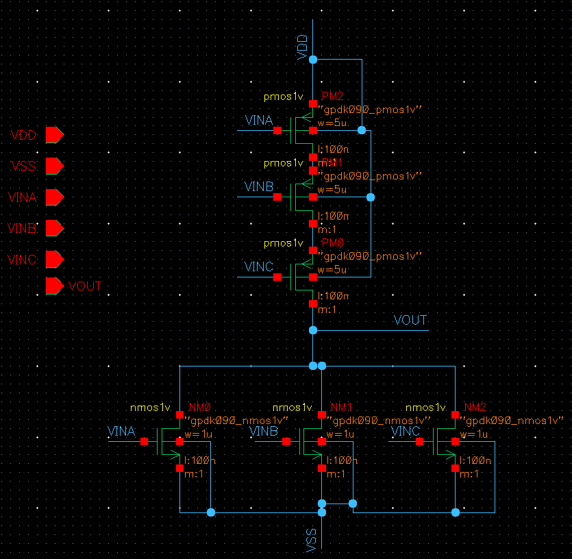
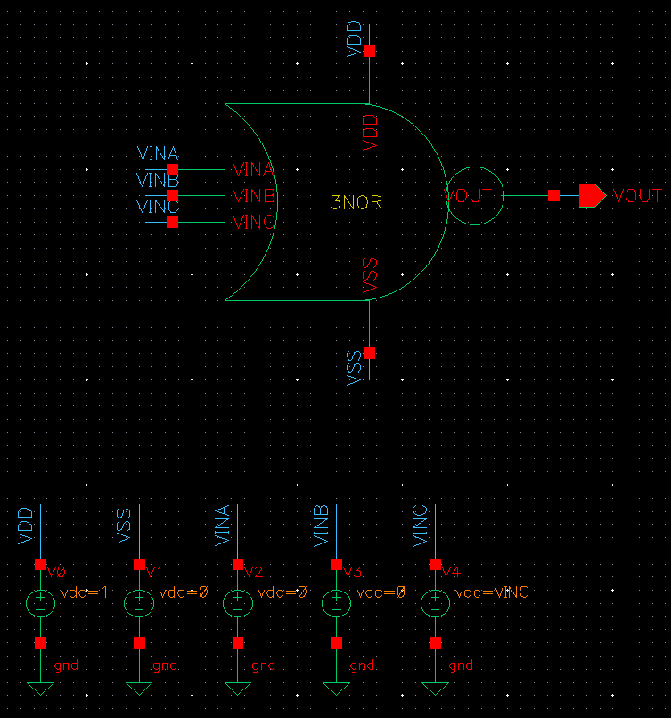
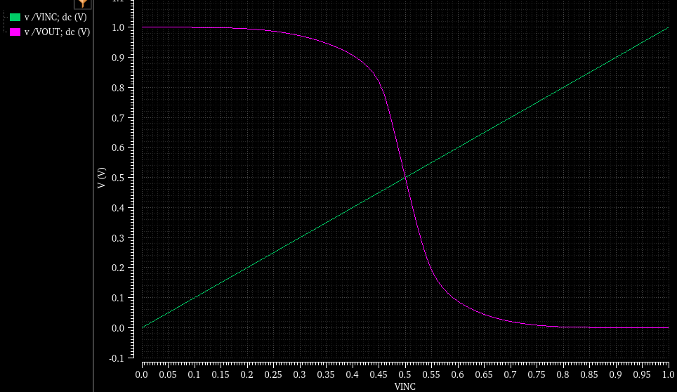
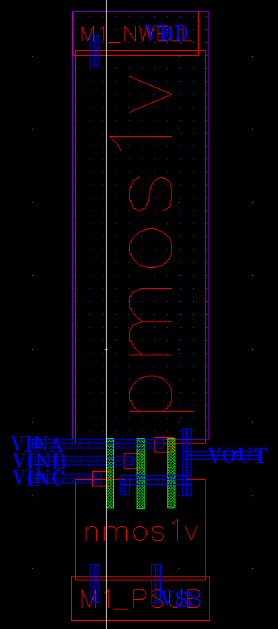
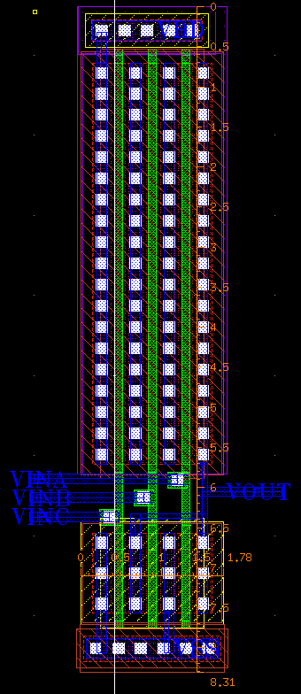
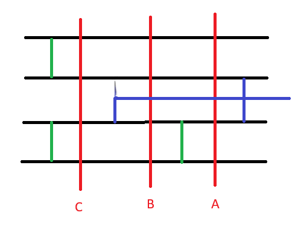

### 1. 3NOR

<small>[1.1. 3NOR Schematic](#11-3nor-schematic)</small>

<small>[1.2. Simulation](#12-simulation)</small>

<small>[1.3. 3NOR Layout](#13-3nor-layout)</small>

---

#### 1.1. 3NOR Schematic

cell view에서 이름은 `3NOR` Type은 `schematic`을 선택하고 3NOR 회로도를 그린다.

NMOS의 width(1u)와 length(100n)는 고정한다. PMOS 3개의 width를 `WIDTH` 변수로 두어 simulation을 진행하고 최적의 값을 찾는다.

`Create`의 `From Cellview`를 클릭하고, 3NOR schematic에 대한 symbol을 생성한다.  

다음과 같이 3NOR Symbol을 사용하여 TEST파일을 만든다.

이때, VINA와 VINB는 0V로 고정하고 VINC를 변수로 두어 ON OFF를 확인한다.

#### 1.2. Simulation

`Launch`의 `ADE L`에서 Schematic에 대한 simulation을 진행한다.

1. `Variables`에서 모든 변수를 불러낸다. 

2. `Analyses`에서 `VINC` 변수의 DC 설정을 진행한다.

3. `WIDTH` 변수에 대해 1u ~ 10u 범위를 설정하고 실행한다.

4. `Results` - `Direct Plot` - `Main Form`에서 그래프 결과를 확인한다.

5. (0.5, 0.5)에 가까운 width 값을 찾는다. 소수점 둘째 자리까지 근사치를 찾는다.

PMOS의 width가 5u일 때 조건을 가장 만족한다.

마지막으로 PMOS의 width 값인 `WIDTH` 변수를 5u로 수정한다.

#### 1.3. 2NOR Layout

PMOS width를 수정한 Schematic을 기반으로 3NOR의 Layout을 진행한다. 

먼저 `Options`의 `Display`에서 x와 y의 `Snap Spacing`을 `0.005`로 수정한다.

전체 Layout은 다음과 같다.

<table>
  <tr>
    <td></td>
    <td></td>
  </tr>
</table>

`gpdk090` Lib PMOS1v 3개를 따로 불러와서 연결하지 않고, Fingers를 3로 수정하여 가로(Length) 길이를 최소화한다. Finger Width는 5u, Total Width는 10u이다.

`gpdk090` Lib NMOS1v의 Fingers는 3, Finger Width를 1u로 설정한다.

2NOR stick diagram에 맞게 poly와 metal을 연결하고 layout을 완성한다.

가로 세로 사이즈는 1.78 * 8.31으로 최소화한다.

마지막으로 Cadence에서 제공하는 Assura 도구로 Schematic과 Layout에 대한 오류를 확인한다.

첫 번째로, `Assura`에서 `DRC(Design Rule Check)`를 진행한다. DRC는 gpdk090을 기준으로 제조 공정 규칙을 준수하는지 확인한다.

두 번째로 `Assura`에서 `LVS(Layout Versus Schematic)`를 진행한다. Schematic과 Layout 간의 회로 연결 및 설계 오류가 없는지 확인한다.

[목차](../../README.md)

