### 1. Inverter

<small>[1.1. Inverter Schematic](#11-inverter-schematic)</small>

<small>[1.2. Simulation](#12-simulation)</small>

<small>[1.3. Inverter Layout](#13-inverter-layout)</small>

---

#### 1.1. Inverter Schematic

cell view에서 이름은 `Inverter` Type은 `schematic`을 선택하고 inverter 회로도를 그린다.

NMOS의 width(1u)와 length(100n)는 고정한다. PMOS의 width를 `WIDTH` 변수로 두어 simulation을 진행하고 최적의 값을 찾는다.

`Create`의 `From Cellview`를 클릭하고, inverter schematic에 대한 symbol을 생성한다.  

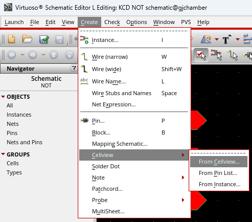

다음과 같이 적절히 도형을 조립하여 Inverter Symbol을 그린다.

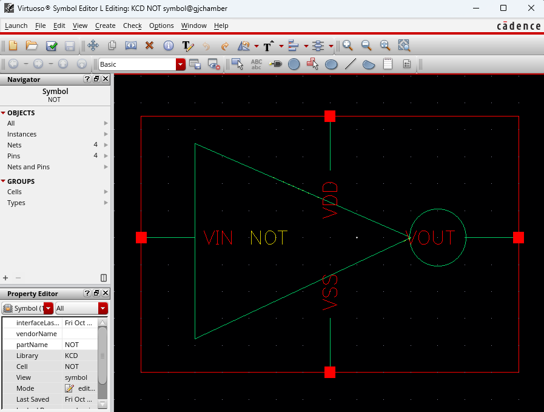

Inverter 회로에 대한 Test 파일을 만들고, 미리 만든 NOT 심볼을 불러낸다.

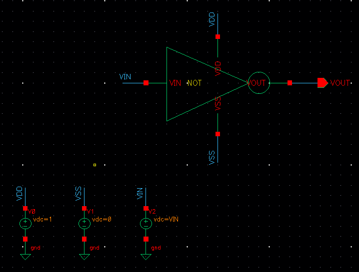

#### 1.2. Simulation

`Launch`의 `ADE L`에서 Schematic 에 대한 simulation을 진행한다.

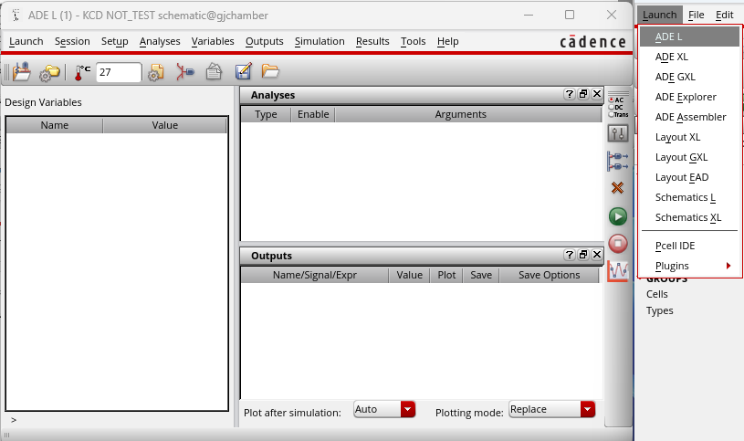

1. `Variables`에서 Inverter의 변수를 불러낸다. 
2. `Analyses`에서 `VIN` 변수의 DC 설정을 진행한다.

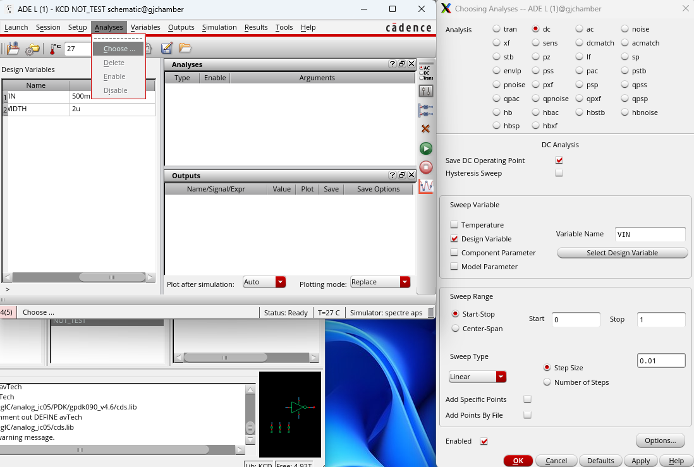

3. `WIDTH` 변수에 대해 1u ~ 10u 범위를 설정하고 실행한다.

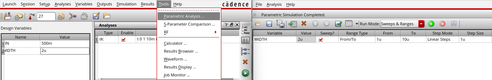

4. `Results` - `Direct Plot` - `Main Form`에서 그래프 결과를 확인한다.

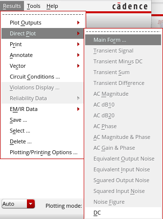

5. (0.5, 0.5)에 가까운 width 값을 찾는다. 2u ~ 3u, 2.9u ~ 3u로 소수점 둘째 자리까지 근사치를 찾는다.

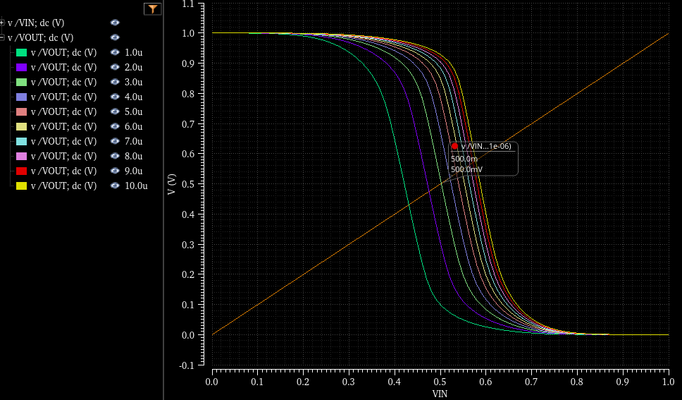
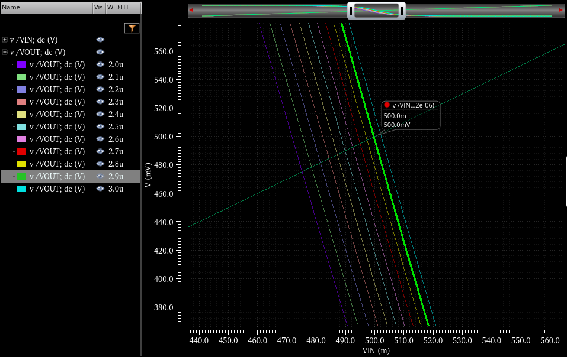
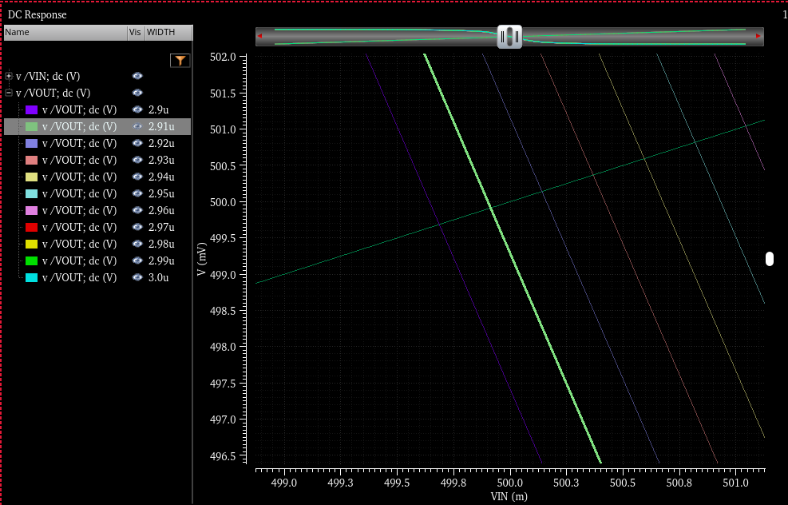

마지막으로 PMOS의 width 값인 `WIDTH` 변수를 2.91u로 수정한다.

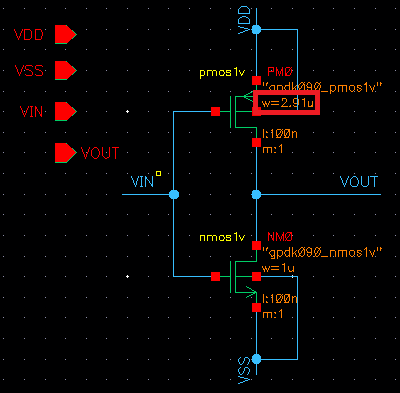

#### 1.3. Inverter Layout

수정한 Schematic을 기반으로 Inverter의 Layout을 진행한다. 

먼저 `Options`의 `Display`에서 x와 y의 `Snap Spacing`을 `0.005`로 수정한다.

전체 Layout은 다음과 같다.

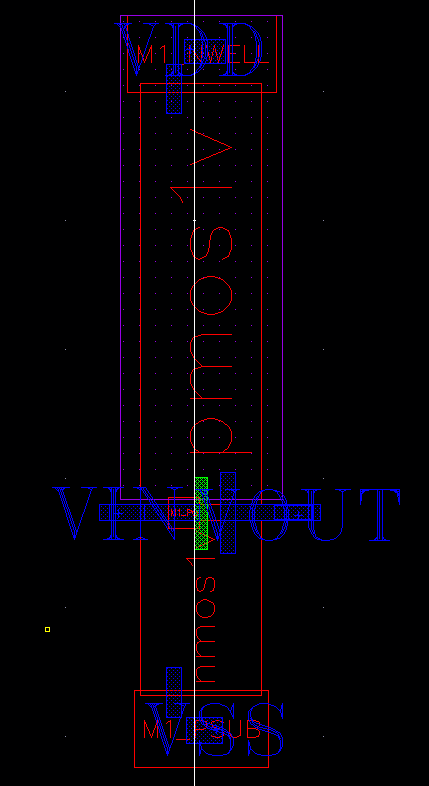
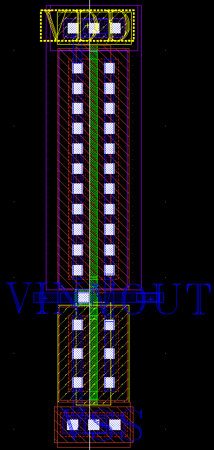

`gpdk090` Lib PMOS의 Finger Width를 2.91u로 설정하고 VDD(body)와 연결한다.

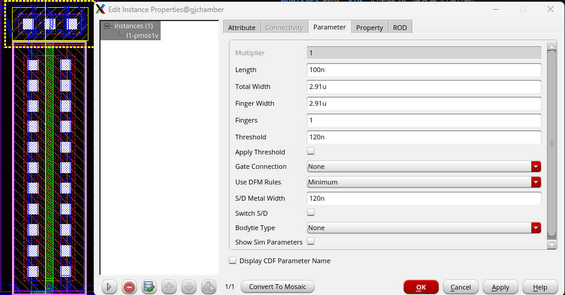

`gpdk090` Lib NMOS의 Finger Width를 1u로 설정하고 VSS(body)와 연결한다.

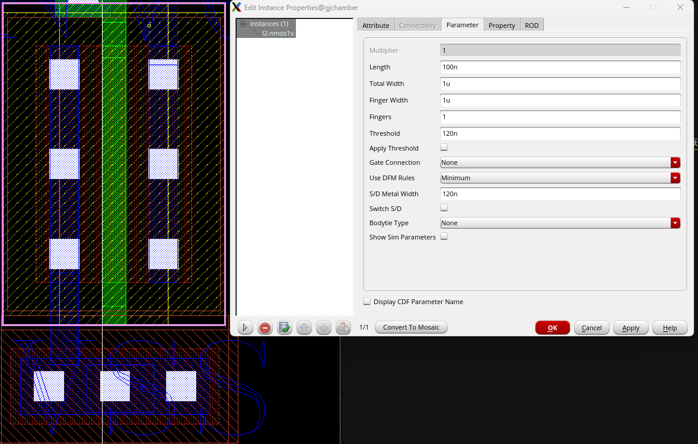

PMOS와 NMOS 사이에 metal1과 poly를 연결하고, VIN-VOUT Label을 붙인다.

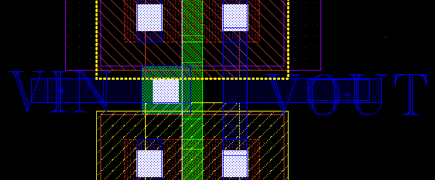

[목차](../../README.md)

